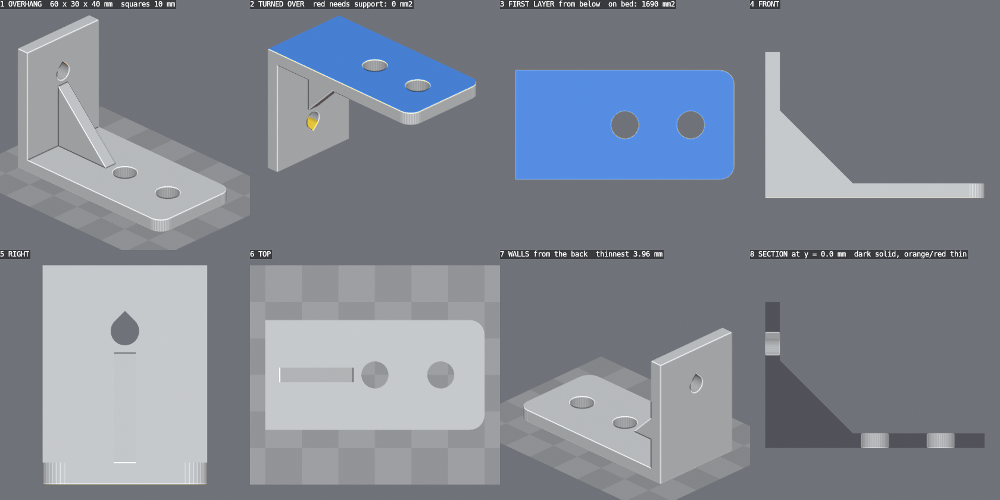
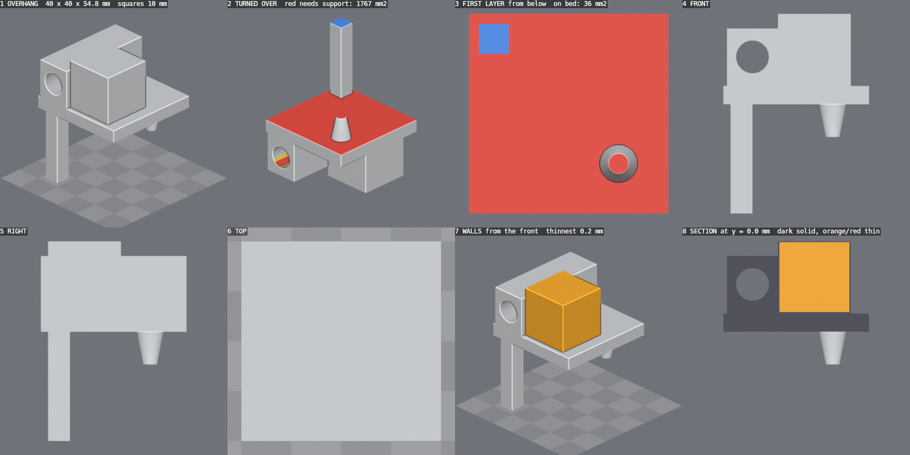

# 3D Print Modeling: an agent skill

Ask your coding agent for a part, and get a model that actually prints: no supports where they
can be designed out, the right way up, walls and holes sized for your nozzle, and a file your
slicer opens ready to go.

This is a skill for agents that can run commands on your computer, such as
[Claude Code](https://claude.com/claude-code) or Codex. It gives the agent a method for
designing printable models and a set of tools, run in headless [Blender](https://www.blender.org),
to check its own work before handing you a file.



*The agent renders a board like this for every model and looks at it: overhangs, the first
layer, wall thickness and a section. This bracket needs no support.*

## What you can ask for

- "Design a wall bracket for two M4 screws that holds a 25 mm pipe."
- "Make a box with a snap-fit lid for a 70 × 50 mm circuit board, printed in PETG."
- "This STL needs supports everywhere. Can you make it print better?"
- "Turn this game model into a 120 mm figurine I can print."
- "Make a name tag with the letters inlaid in a second colour."
- "Split this helmet so it fits my printer, with pins to line the halves up."

It works for any kind of model: brackets, enclosures, replacement parts, figurines, miniatures,
terrain, props, print-in-place toys, vases. It covers filament (FDM), resin and powder (SLS)
printers.

## Get started

**1. Install [Blender](https://www.blender.org/download/) 5.0 or newer.** No add-ons needed.
You also need Python 3.9 or newer, which most systems already have.

**2. Put the skill in your agent's skills folder.**

Claude Code:

```
git clone https://github.com/kshaham/3d-print-modeling-skill ~/.claude/skills/3d-print-modeling
```

Codex:

```
git clone https://github.com/kshaham/3d-print-modeling-skill ~/.codex/skills/3d-print-modeling
```

On Windows, `~` is your user folder, for example `C:\Users\you\.claude\skills\3d-print-modeling`.

**3. Check that it works** (a few seconds):

```
cd ~/.claude/skills/3d-print-modeling
python scripts/blender_run.py self_test.py
```

It should end with `SELF-TEST PASS  30 of 30`. If it says Blender was not found, tell it where
Blender is once:

```
python scripts/blender_run.py --set-blender "/path/to/blender"
```

**4. Start a new session with your agent and ask for something printable.** The first time, it
asks three questions and remembers the answers:

1. Which 3D printer do you have?
2. How many colours can it print at once?
3. Which materials do you print with?

Until you answer, it assumes a Bambu Lab P1S with a 0.4 mm nozzle and PLA.

## What you get back

- `part.3mf` (and `part.stl` if you want it), in millimetres, already turned the way it should
  print and sitting on the bed.
- `part.json`: size, parts and colours, the check results and the slicer settings that matter.
- A review board image like the one above.
- A short note: orientation, whether supports are needed and why, material, settings, and the
  expected time and filament.

## How it keeps models printable

The agent does not just draw a shape and export it. For every model it runs a printability
check and fixes what the check finds:

```
PASS  fdm on Bambu Lab P1S  60 x 30 x 40 mm  892 triangles  1 part(s)  1 shell(s)  11.86 cm3
  bed contact 1690 mm2   support needed on 0 mm2 (0.0 cm3)   bridges 0   mid-air starts 0
  thinnest wall 3.96 mm   rough estimate 9.0 g pla, 25 min, 200 layers
```

The check covers:

- **Is it a real solid?** Holes in the mesh, inside-out or overlapping pieces, wrong units.
- **Does it fit?** Against your printer's build volume.
- **Will each layer have something under it?** Overhangs past 45°, bridges that are too long
  for the material, and parts that start in mid-air.
- **Is anything too thin, or too close?** Walls below what your nozzle can print, and gaps so
  small that moving parts would fuse.
- **Will it stay on the bed?** First-layer contact, tall narrow parts, centre of mass.
- **Resin and powder:** sealed cavities that would trap resin or powder.
- **Colour:** how many layers change filament, which is what makes multi-colour prints slow.

Here is the same board for a deliberately bad model. Red needs support, orange is a wall too
thin to print well, blue is the only part touching the bed:



When a problem can be designed away, the agent does that rather than adding supports: a 45°
chamfer under a ledge, a teardrop instead of a round hole on its side, a different way up, or a
split into two parts that each print flat.

## Real print times from your slicer

If Bambu Studio, OrcaSlicer or PrusaSlicer is installed, the agent slices the finished model
with your printer's own profile and quotes real numbers:

```
python scripts/print_slice.py out/wall-bracket.3mf --compare-supports

SLICED  wall-bracket.3mf  with bambu-studio.exe for Bambu Lab P1S 0.4 nozzle, 0.20mm Standard @BBL X1C, Bambu PLA Basic @BBL P1S 0.4 nozzle
  no supports    22 min  8.4 g  2.77 m  200 layers
  with supports  22 min  8.4 g  2.77 m  200 layers
  supports cost 0 min and 0.0 g
```

Multi-colour models are exported so that Bambu Studio opens them as one object with a filament
already assigned to each colour.

Without a slicer the agent still gives an estimate, and says that it is a rough one.

## Using the tools yourself

Everything the agent uses also works from a terminal, on any model file
(`.stl .3mf .obj .ply .glb .gltf .blend`):

| Command | What it does |
| --- | --- |
| `python scripts/blender_run.py print_check.py model.stl` | printability report; exit code 1 if the model fails |
| `python scripts/blender_run.py print_orient.py model.stl --top 5` | ranks the ways the model can sit on the bed |
| `python scripts/blender_run.py print_orient.py model.stl --apply best.3mf` | writes the best orientation |
| `python scripts/blender_run.py print_review.py model.stl review.png` | renders the review board |
| `python scripts/print_slice.py model.3mf --compare-supports` | real time and filament from your slicer |
| `python scripts/printer_profile.py --show` | the saved printer, colours and materials |
| `python scripts/printer_profile.py --set printer="Prusa MK4S" colors=1 materials=PLA,PETG` | change them |
| `python scripts/printer_profile.py --printers` | printers known by name |
| `python scripts/blender_run.py assets/author_template.py --review --out out` | builds the example bracket |
| `python scripts/blender_run.py assets/author_fit_gauge.py --out out` | builds a clearance gauge for your printer |

Add `--material petg`, `--nozzle 0.6`, `--process resin` and similar to any check to override
the saved printer.

## What is inside

| Path | What it is |
| --- | --- |
| `SKILL.md` | the instructions the agent follows |
| `references/` | design rules for each process, printing efficiently, functional parts and fits, multi-colour, materials, converting existing models, playbooks per kind of model, slicer hand-off |
| `scripts/` | the checker, orientation ranker, review renderer, exporter, slicer driver, printer profile, modeling helpers and self-test |
| `assets/` | a complete example part to copy, and the clearance gauge |

## What has and has not been tested

- Developed and tested on Windows with Blender 5.2, Bambu Studio 2.9 and PrusaSlicer 2.9.
- macOS and Linux should work (the tools look for Blender and the slicers in their usual
  places there) but have not been tested. Reports are welcome.
- OrcaSlicer takes the same path as Bambu Studio but has not been tested.
- The multi-colour hand-off was verified through Bambu Studio's command line, not by hand in
  its window.
- The checker's own time and mass figures are estimates for comparing two versions of a design.
  Use the slicer's numbers when the time matters.
- Models are built as meshes in Blender. For precise mechanical parts that is usually enough;
  the skill says when a CAD kernel would serve better.
- Nothing here replaces a test print. Printed parts are not certified for safety-critical use.

## Troubleshooting

| Problem | Fix |
| --- | --- |
| `Blender not found` | `python scripts/blender_run.py --set-blender "/path/to/blender"` |
| `no slicer found` | install your slicer, or `python scripts/print_slice.py --set-slicer "/path/to/slicer"` |
| The agent does not use the skill | check the folder name and location, then start a new session; ask for it by name ("use the 3d-print-modeling skill") |
| It asks about your printer again | `python scripts/printer_profile.py --show` should list your printer; if not, set it as in the table above |
| A check result looks wrong | run `python scripts/blender_run.py self_test.py` and open an issue with its output and the model |

## Contributing

Issues and pull requests are welcome, especially test reports from macOS, Linux, OrcaSlicer and
other printers. Run the self-test before and after a change.

## Licence and credits

[MIT](LICENSE). Blender discovery in `scripts/blender_run.py` is adapted from
[EL4CTEO/blender-skills](https://github.com/EL4CTEO/blender-skills) (MIT); see
`THIRD_PARTY_NOTICES.md`.
